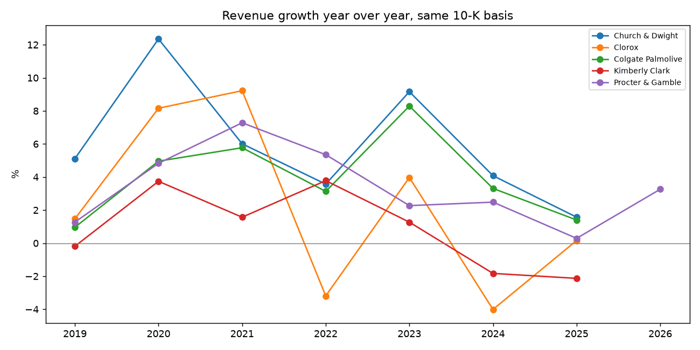
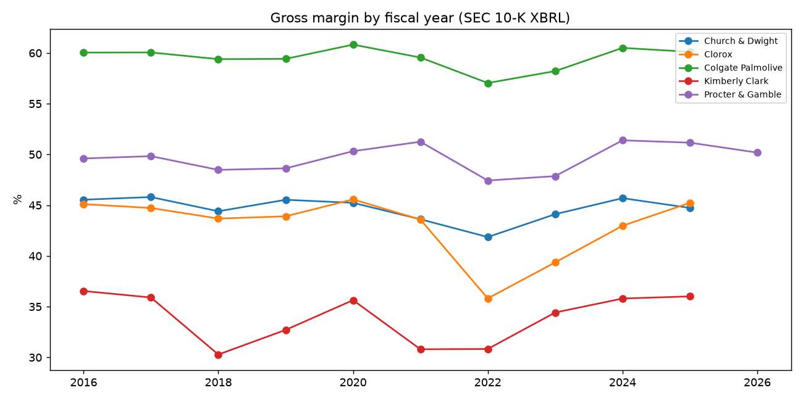
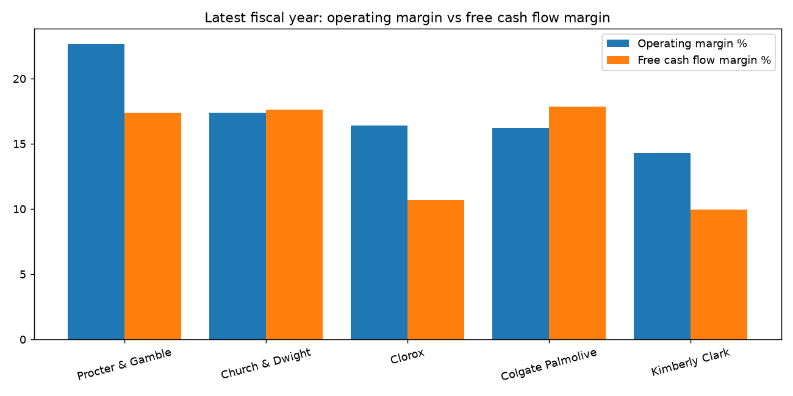
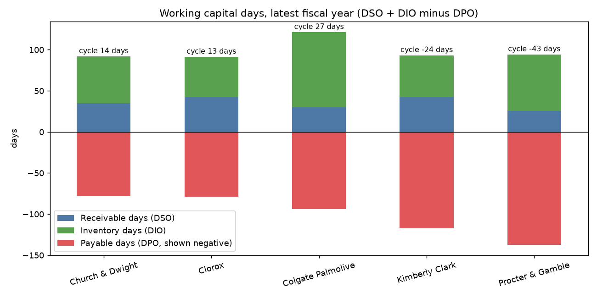

# Consumer Products 10-K Financial Analysis from SEC XBRL Data

**Question:** Across five US household and personal care companies, who is growing, who holds margin, and who turns profit into cash fastest?

All figures come straight from the companies' 10-K filings, pulled as structured XBRL data from SEC EDGAR.

## Data sources

| Source | What I pulled | Link | Pull date |
|---|---|---|---|
| SEC EDGAR XBRL company facts API | Every 10-K value for revenue, cost of sales, operating income, net income, operating cash flow, capex, receivables, inventory, payables and assets | https://data.sec.gov/api/xbrl/companyfacts/ (docs: https://www.sec.gov/search-filings/edgar-application-programming-interfaces) | 2026-11-14 |

Companies (CIK): Procter & Gamble (80424), Colgate Palmolive (21665), Kimberly Clark (55785), Clorox (21076), Church & Dwight (313927).

Requests identify the requester with a User-Agent header and stay well under SEC's 10 requests per second guidance. The flattened snapshot is in `data/annual_facts.csv` (one row per value per filing, with the XBRL tag and accession number), so the analysis runs offline.

## What I built

1. `fetch_data.py` downloads company facts and keeps only annual 10-K values, with a priority list of XBRL tags per metric because companies tag the same line differently.
2. `analyze.py` builds the ratio set for fiscal years 2016 to the latest 10-K:
   * **Revenue growth year over year on a same filing basis:** current and prior year both taken from the same 10-K, so divestitures and restatements do not distort growth. Example: Kimberly Clark's FY2025 10-K restated FY2024 revenue from $20,058M to $16,805M. Comparing raw totals would show an 18% drop; on the same filing basis FY2025 growth is minus 2.13%.
   * Gross, operating, net and free cash flow margins
   * Cash conversion = operating cash flow / net income
   * Receivable, inventory and payable days, and the cash conversion cycle
3. Exports `outputs/consumer_products_10k_analysis.xlsx` (peer dashboard, ratio history, source values) plus CSVs and charts.

Notes: fiscal year = calendar year of the period end. P&G and Clorox close their year in June, so P&G's latest is FY2026 (June 2026) and the others are FY2025. Clorox does not tag an operating income line, so its operating margin uses pretax income plus interest expense as an EBIT proxy (flagged in `outputs/ratio_history.csv`).

## Key findings (latest 10-K)

| Company | Revenue $M | Avg growth, last 5 yrs % | Gross margin % | Operating margin % | FCF margin % | Cash cycle, days |
|---|---|---|---|---|---|---|
| Procter & Gamble (FY2026) | 87,032 | 2.73 | 50.18 | 22.69 | 17.40 | minus 43.1 |
| Church & Dwight | 6,203 | 4.88 | 44.73 | 17.37 | 17.62 | 13.9 |
| Clorox | 7,104 | 1.23 | 45.23 | 16.41 | 10.71 | 12.6 |
| Colgate Palmolive | 20,382 | 4.38 | 60.11 | 16.22 | 17.83 | 27.4 |
| Kimberly Clark | 16,447 | 0.53 | 36.01 | 14.29 | 9.97 | minus 24.4 |

* **Growth leaders:** Church & Dwight (4.88% average) and Colgate Palmolive (4.38%) grew fastest over the last five fiscal years. Kimberly Clark averaged 0.53% and shrank in each of its last two years (minus 1.83% and minus 2.13%).
* **Margin:** P&G has the highest operating margin at 22.69%. Colgate has the richest gross margin at 60.11% but spends more below gross profit, landing at 16.22% operating margin.
* **Clorox recovery:** operating margin went from 4.44% in FY2023 to 16.41% in FY2025, and gross margin from 35.81% in FY2022 to 45.23%.
* **Working capital:** P&G runs a negative cash conversion cycle of 43 days (suppliers fund its working capital). Kimberly Clark cut its cycle by 24.5 days over five years, the biggest improvement in the group.
* **Cash quality:** every company converted more than 1x net income into operating cash flow on average over the last five years (P&G 1.19x up to Clorox 2.99x, the latter lifted by low net income years).

## Charts









## How to run

```bash
pip install -r requirements.txt
python fetch_data.py   # optional, refreshes data/ from SEC EDGAR (edit the User-Agent to your own name and email)
python analyze.py      # writes CSVs, charts and the Excel workbook to outputs/
```

## Stack

Python (pandas, requests, matplotlib, openpyxl), SEC EDGAR XBRL API, Excel.

## Conclusion

Pulling ratios directly from XBRL makes a peer comp repeatable: one script refreshes five companies as soon as a new 10-K posts, and the same filing basis growth check catches restatements that would otherwise make a company look like it shrank. In this group, Church & Dwight and Colgate combine the best growth with strong free cash flow, while Kimberly Clark's story is working capital discipline rather than growth.
